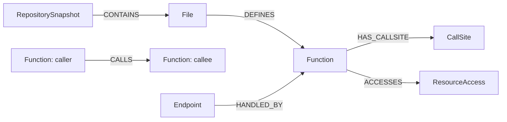
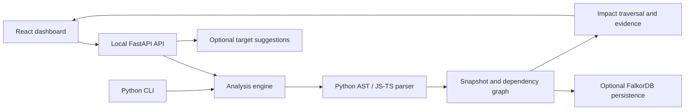

# GraphScope

Understand the potential blast radius of a code change before making it.

GraphScope maps source dependencies, traces callers and affected API endpoints,
compares Git revisions, and inspects dependencies across declared service workspaces.
Findings include source locations, resolution rules, and explicit analysis limitations.

**Status:** local-first hackathon beta. Python and a subset of JavaScript/TypeScript
are supported. Results describe potential static impact, not guaranteed runtime behavior.

## Hackathon submission

- **Source code:** [GraphScope repository](https://github.com/Souhardya0903/GraphScope).
- **Setup instructions:** [Quick start](#quick-start) and [Verification](#verification).
- **Graph data model:** [Nodes and relationships](#graph-data-model).
- **Queries and algorithms:** [Core graph operations](#cypher-queries-and-graph-algorithms).
- **Demo video:** Recorded locally; public viewing link pending.
- **Entry tracks:** Track 01 — Agents That Act on Connected Data; Track 02 — Agent
  Memory and Coordination; Track 03 — Company Brain.

### Track alignment

| Track | Implemented connection | Current boundary |
|---|---|---|
| **01 — Agents That Act on Connected Data** | The stored-snapshot investigator uses bounded graph tools for symbol resolution, multi-hop traversal, endpoint discovery, and source evidence. It selects a target and produces graph-backed findings and review recommendations. | Strongest fit. Provider-native function calling is implemented; MCP tool selection and autonomous code modification are not. |
| **02 — Agent Memory and Coordination** | FalkorDB persists repository snapshots that can be investigated across sessions. | Persistent code state is implemented, not episodic/semantic/procedural agent memory, conversation history, multi-agent handoffs, or tenant-separated memory. |
| **03 — Company Brain** | Source-backed repository and service relationships provide a focused engineering knowledge graph with explainable dependency paths. | Scope is code and declared service contracts; people/team ownership and document, ticket, chat, or decision ingestion are not implemented. |

The track list records the intended entries; it does not imply that every focus
area in each track is implemented. The main repository-analysis dashboard also
works offline; use the stored-snapshot investigation workflow to demonstrate an
agent querying the persisted FalkorDB graph.

## What you can do

| Analysis mode | Purpose |
|---|---|
| Repository mapping | Explore functions, resolved calls, endpoints, and resource accesses. |
| Selected targets | Trace potential impact from one or more exact function names or a literal resource identity. |
| Proposed change | Describe an intended change, review candidate functions, and confirm targets before calculating impact. |
| Git changes | Map worktree, staged, or committed edits to symbols and inspect before/after impact. |
| Service workspace | Map declared services and infer HTTP/message dependencies, with service filtering and contract evidence. |

The React dashboard includes graph fitting, zoom/pan, node selection, dependency
evidence, grouped coverage reporting, and JSON export. Static test links identify
resolved caller relationships to tests; they do not execute tests or measure runtime coverage.

## Quick start

### 1. Install prerequisites

Use Windows PowerShell, macOS Terminal, or a Linux shell. GraphScope runs from a
source checkout; a standalone wheel-only installation is not supported by this beta.

| Requirement | Version / purpose |
|---|---|
| [Git](https://git-scm.com/downloads) | Clone the project and compare repository revisions. |
| [Python](https://www.python.org/downloads/) | 3.11+ with pip and venv support. Python 3.12 is used in Linux CI; the dependency snapshot was originally recorded on Windows/Python 3.15. |
| [Node.js and npm](https://nodejs.org/en/download) | Node 22.12+; Node 24 is used for release verification. Required for the dashboard build and JS/TS source parser. |
| Browser | A modern desktop browser for the dashboard. |
| Docker with Compose | Optional: only needed if running FalkorDB locally. |

Check your terminal can find the tools:

Windows:

```powershell
git --version
python --version
python -m pip --version
node --version
npm --version
```

macOS/Linux:

```sh
git --version
python3 --version
python3 -m pip --version
node --version
npm --version
```

Reopen the terminal after installing tools. On Windows, if only `py` is available,
use `py --version` and pass `-Python py` to the setup script below. On Linux, install
your distribution's Python pip/venv packages if those modules are unavailable.

### 2. Clone or update

For a fresh checkout, run on any of these systems:

```sh
git clone https://github.com/Souhardya0903/GraphScope.git
cd GraphScope
```

For an existing checkout, save your local edits before updating:

```sh
git switch main
git pull --ff-only origin main
```

Run all remaining commands from this GraphScope directory. No particular drive,
username, editor, or absolute checkout location is required.

### 3. Install GraphScope

The scripts create `.venv`, install pinned Python runtime/development dependencies
from `requirements.lock.txt`, install GraphScope in editable mode, install the
JavaScript parser and frontend dependencies, build the dashboard, and run diagnostics.
Initial setup requires internet access to package registries. The dependency snapshot
is not an artifact-hashed cross-platform lockfile; unsupported package/platform
combinations can still require adjustment.

Windows PowerShell:

```powershell
powershell -ExecutionPolicy Bypass -File scripts/setup.ps1
```

If your Python launcher is `py` instead of `python`:

```powershell
powershell -ExecutionPolicy Bypass -File scripts/setup.ps1 -Python py
```

macOS/Linux:

```sh
sh scripts/setup.sh
```

To select another installed Python on macOS/Linux, use, for example,
`PYTHON=python3.12 sh scripts/setup.sh`. Choose it before creating `.venv`; changing
the setting does not replace an existing environment.

If you prefer manual setup, these are the equivalent steps:

Windows:

```powershell
python -m venv .venv
.\.venv\Scripts\python.exe -m pip install -r requirements.lock.txt
.\.venv\Scripts\python.exe -m pip install -e . --no-deps
npm ci --prefix tools/javascript --ignore-scripts
npm ci --prefix frontend --ignore-scripts
npm --prefix frontend run build
.\.venv\Scripts\python.exe -m graphscope doctor
```

macOS/Linux:

```sh
python3 -m venv .venv
.venv/bin/python -m pip install -r requirements.lock.txt
.venv/bin/python -m pip install -e . --no-deps
npm ci --prefix tools/javascript --ignore-scripts
npm ci --prefix frontend --ignore-scripts
npm --prefix frontend run build
.venv/bin/python -m graphscope doctor
```

Virtual-environment activation is optional; the commands use its Python directly.

### 4. Start the dashboard and API

Windows:

```powershell
.\.venv\Scripts\python.exe -m graphscope serve --port 8080
```

macOS/Linux:

```sh
.venv/bin/python -m graphscope serve --port 8080
```

Leave that terminal running and open **http://127.0.0.1:8080**. The server serves
the dashboard and API together; no separate Vite server is required. Stop it with
**Ctrl+C**. If the port is occupied, use `--port 8081` and open that port instead.

All five repository-analysis modes work without Docker, FalkorDB, or an LLM key.
For external repositories, replace the paths below with your own local directories:

```powershell
.\.venv\Scripts\python.exe -m graphscope serve --allow-root "C:\path\to\repository"
```

```sh
.venv/bin/python -m graphscope serve --allow-root /path/to/repository
```

Repeat `--allow-root` for additional directories. For a workspace, allow the manifest's
parent and each external service root. The GraphScope checkout is allowed by default.
Paths refer to the server's filesystem, not a GitHub URL. Network shares are rejected.

### 5. Check the installation

In a second terminal at the checkout root, run diagnostics:

```powershell
.\.venv\Scripts\python.exe -m graphscope doctor
```

```sh
.venv/bin/python -m graphscope doctor
```

`git`, `node`, `parser_installed`, and `frontend_built` should be `true`.
`providers_configured` and `falkordb_host_configured` may be `false` for offline use.
Doctor checks presence/configuration, not live provider or database connectivity.

Open **http://127.0.0.1:8080/api/health** in the browser. Expect a JSON response with
`status: "ok"`. Then choose **Repository mapping** in the dashboard, enter the
absolute path of a local Python or JS/TS repository, and click **Analyze repository**.
Verify that a report appears, inspect its limitations, and export JSON. Findings
depend on the source; zero detected routes do not mean the installation is broken.

## Analyze your repository

Start the server with your repository directory allowed, then open the dashboard:

1. Choose an analysis mode and enter your repository's absolute path.
2. For target impact, enter an exact qualified function name from its map, or a
   literal resource identity. Use one selector at a time.
3. For a proposed change, describe the change, review candidate functions, and
   confirm the targets before calculating impact.
4. For Git changes, choose the base revision and compare against the worktree,
   staging index, or another revision.
5. For multiple services, provide a workspace JSON manifest. Inspect its map or
   select a service and target; alternatively select one changed service.

Workspace manifests have version `1` and a `services` array. Each service declares
an `id`, local `root`, and HTTP `base_url`. Optional `revision` pins source to a Git
ref or index; optional `message_broker` identifies a shared messaging namespace.
Service paths resolve relative to the manifest and must be under allowed roots.

Select graph nodes for dependency evidence, review coverage limitations, and export
JSON when you need the full report. Cross-service links are inferred contracts,
not observations of runtime traffic.

## Optional LLM suggestions

**Proposed change** supports offline lexical matching, Gemini, Ollama Cloud, and OpenAI.
Click **Describe a change**, choose a provider, and leave targets empty to request suggestions.
The UI asks permission to share the description and symbol catalog. Review the candidate,
select it, and explicitly confirm before calculating static impact. Confirmation does
not make another model request. Provider failures offer an offline fallback.

Create an ignored `.env` file using `.env.example` as a template, without overwriting
existing configuration. Set the selected provider's key and a tool-capable model ID
available to your account:

```dotenv
GEMINI_API_KEY=your-key
GEMINI_MODEL=your-model
# Alternatives:
# OLLAMA_API_KEY / OLLAMA_MODEL
# OPENAI_API_KEY / OPENAI_MODEL
```

Restart the server after changing configuration. Credentials stay on the server.
Proposal requests send a description, symbol names/IDs, and relative file paths;
they exclude source contents. Catalogs are limited to **300 functions / 45,000
characters**, with a 30-second model-request timeout. Larger repositories can use
offline matching or explicit targets. Provider access and quota are account-dependent.

LLMs suggest targets and manual checks. Source analysis and graph traversal establish
the reported dependencies; model text cannot supply dependency edges.

## CLI

Use the virtual environment's Python executable. The following syntax uses
placeholders: replace `REPOSITORY_PATH`, `QUALIFIED_FUNCTION`, and `MANIFEST_PATH`
with your own values.

```text
python -m graphscope.analysis map REPOSITORY_PATH --output reports/map.json
python -m graphscope.analysis impact REPOSITORY_PATH --target QUALIFIED_FUNCTION
python -m graphscope.analysis changes REPOSITORY_PATH --base HEAD --head worktree
python -m graphscope.analysis propose REPOSITORY_PATH "CHANGE DESCRIPTION"
python -m graphscope.analysis workspace MANIFEST_PATH
```

Run `python -m graphscope.analysis MODE --help` for command options. A confirmed
proposal requires explicit `--target` and `--confirm`. Git comparisons accept
`--head index` for staged edits or a commit/ref for another revision.

## Optional FalkorDB snapshots and investigations

FalkorDB is required for **Stored snapshot investigation**, not offline repository
analysis. Configure it only if you want persistent graph snapshots and investigations.

### Configure local or cloud access

For a local database, install and start Docker with Compose, then run from the checkout:

```sh
docker version
docker compose version
docker compose up -d --wait
docker compose ps
```

Expect the FalkorDB container to be healthy. The local database uses `localhost:6379`;
its browser is at **http://localhost:3000**. Data persists in a Docker volume.

Create `.env` once from `.env.example` if you have no existing configuration:

```powershell
if (-not (Test-Path .env)) { Copy-Item .env.example .env }
```

```sh
if [ ! -f .env ]; then cp .env.example .env; fi
```

For local Docker, use:

```dotenv
FALKORDB_HOST=localhost
FALKORDB_PORT=6379
FALKORDB_USERNAME=
FALKORDB_PASSWORD=
FALKORDB_SSL=false
FALKORDB_GRAPH=graphscope
```

For FalkorDB Cloud, use your instance's host, port, username/password, and supported
TLS setting instead. Cloud access does not require local Docker. Shell environment
variables take precedence over `.env`; remove stale overrides when switching instances.
Restart the server after changing configuration. Keep `.env` out of Git.

### Verify, store, and investigate

Check connectivity in a second terminal:

```powershell
.\.venv\Scripts\python.exe scripts/check_falkordb.py
```

```sh
.venv/bin/python scripts/check_falkordb.py
```

The check writes, reads, and removes a disposable graph. Success verifies database
access, including a graph operation, rather than merely checking a TCP port.

In **Stored snapshot investigation**, use **Ingest Local**, enter an allowed local
repository path, and wait for the snapshot. Select it, enter a question and an exact
qualified target from that repository, and choose **None (direct graph resolve)**
for database-backed deterministic investigation. Model providers are optional.
Keep source sharing unchecked unless you intend to send excerpts to the provider.

Alternatively, use `graphscope.analysis map REPOSITORY_PATH --store --output
reports/stored-map.json` with the environment's Python. The stored map includes
an `id` for `graphscope.investigation`; run that command with `--help` for its syntax.
Source excerpts are opt-in and checked against indexed hashes. They require access
to the original local checkout; storing a cloud snapshot does not upload whole files.

Stop the local database with `docker compose down`. Do not add `--volumes` if you
want to retain its stored data.

## Coverage and limits

- Python resolution supports explicit imports, unambiguous re-exports, package/submodule
  calls, and a bounded subset of class-method lookup and FastAPI routes.
- Dynamic dispatch, arbitrary decorators, nested functions, runtime-generated routing,
  and other unsupported patterns can leave dependencies unresolved.
- JavaScript/TypeScript analysis supports a subset of functions/imports and literal
  HTTP calls. Java and universal framework/language support are not implemented.
- Resource identities and cross-service contracts can be inferred and require review.
- Analysis coverage separates repository-wide limitations, unresolved calls inside
  found affected functions, and builtin calls. The scoped view does not prove other
  code is unrelated; unresolved incoming calls may hide additional dependents.
- Graph previews are bounded; exports preserve full report relationships. Traversal
  truncation and depth limits are explicitly reported.

An empty impact result does not establish safety. Analysis never imports or executes
repository source. This beta binds to loopback and assumes a trusted local operator;
public multi-user hosting, tenant isolation, and authentication are not implemented.

## Verification

Run checks from the checkout root after setup. They exercise source analysis and
contracts; they do not import or run arbitrary repositories you choose to analyze.

Windows:

```powershell
.\.venv\Scripts\python.exe -m pip check
.\.venv\Scripts\python.exe -m ruff check src tests examples
.\.venv\Scripts\python.exe -m pytest tests/unit -q
```

macOS/Linux:

```sh
.venv/bin/python -m pip check
.venv/bin/python -m ruff check src tests examples
.venv/bin/python -m pytest tests/unit -q
```

Expect no broken requirements, a clean lint result, and passing unit tests. A known
HTTP test-client deprecation warning may appear. Counts can differ with locally
retained untracked tests; use failures rather than a fixed count to judge success.

Frontend checks on all three platforms:

```sh
npm --prefix frontend run build
npm --prefix frontend test -- --maxWorkers=1
npm --prefix frontend exec -- playwright install chromium
npm --prefix frontend run test:e2e
```

On Linux systems missing browser libraries, run the Playwright installation with
`--with-deps` (it may need administrator access). Browser tests launch a separate
server on **8765**; keep it free. Tests for optional ignored third-party clones may
be skipped on a fresh checkout; bundled-example tests should run. These checks use
mocked provider responses rather than paid LLM calls.

For optional live FalkorDB integration tests, configure a reachable instance first.
The tests create and delete uniquely named test graphs. Enable the explicit opt-in:

```powershell
$env:GRAPHSCOPE_INTEGRATION = "1"
.\.venv\Scripts\python.exe -m pytest tests/integration -q
Remove-Item Env:GRAPHSCOPE_INTEGRATION
```

```sh
GRAPHSCOPE_INTEGRATION=1 .venv/bin/python -m pytest tests/integration -q
```

For a manual acceptance check, analyze your repository, inspect a selected function's
callers and endpoint evidence, compare a saved Git edit, and verify JSON export.
For proposals, review and confirm candidates; for workspaces, inspect service cards
and contract evidence. Invalid paths/targets should show errors, and changing inputs
should clear stale results. Report the commit (`git rev-parse --short HEAD`), OS,
tool versions, inputs, and sanitized error if something fails.

### Updating an existing installation

Stop the server, save your own edits, update the checkout, rerun the platform setup
script above, then restart the server and hard-refresh the browser. Rerunning setup
updates dependencies/assets but does not replace an existing `.venv` interpreter or
reset your `.env`. Never copy another developer's `.venv` between systems.

## Project layout

```text
frontend/                 React + TypeScript dashboard and browser tests
src/graphscope/
  ingestion/              Python AST extraction and dependency resolution
  analysis/               Maps, changes, proposals, impact, and service workspaces
  api/                    Local FastAPI endpoints and filesystem boundaries
  graph/                  FalkorDB snapshot persistence and queries
  investigation/          Bounded optional model/tool investigation
  models.py               Shared report and snapshot contracts
examples/commerce/        Bundled function/endpoint demonstration
examples/workspace/       Bundled Python/TypeScript service contracts
scripts/                  Setup and database verification
tools/javascript/         JavaScript/TypeScript source parser
tests/                    Unit, fixture, and integration checks
```

## Graph data model

The contracts are defined in [models.py](src/graphscope/models.py); FalkorDB node
and relationship writes are implemented in [repository.py](src/graphscope/graph/repository.py).

| Node label | Important properties | Purpose |
|---|---|---|
| `RepositorySnapshot` | `id`, `root`, `indexed_at`, `status`, `metadata`, `digest` | Captures an extraction and its revision metadata; stored snapshots become queryable only when ready. |
| `File` | `id`, `snapshot_id`, `relative_path`, `module`, `content_hash`, `parse_status` | Identifies source and supports hash-checked evidence. |
| `Function` | `id`, `snapshot_id`, `qualified_name`, `file_path`, `start_line`, `end_line`, `signature` | Represents a function or supported method definition. |
| `CallSite` | `id`, `snapshot_id`, `owner_id`, `target_text`, `line`, `target_id`, `resolution_status`, `reason` | Retains resolved and unresolved call expressions. |
| `Endpoint` | `id`, `snapshot_id`, `method`, `path`, `handler_id`, `mount_evidence` | Represents a detected API route and its declared handler. |
| `ResourceAccess` | `id`, `snapshot_id`, `owner_id`, `kind`, `operation`, `value`, `rule`, `confidence` | Records HTTP, Redis/cache, SQL, environment, or messaging access. |



`CALLS` points from caller to callee. Its evidence includes `callsite_id`,
`file_path`, `line`, `rule`, and `confidence`; stored call edges also carry
`snapshot_id`. Impact analysis traverses those dependencies in reverse.
Extraction gaps are retained in snapshot/report data rather than invented as
function edges. Source references and hashes are stored; whole source files are not
uploaded as graph nodes.

Workspace contracts link function identities across service snapshots. They are
labelled inferred and include HTTP origin/method/route or broker/topic evidence.
The combined workspace projection is analyzed locally; individual repository maps
can be persisted to FalkorDB.

## Cypher queries and graph algorithms

The executable query implementation is [queries.py](src/graphscope/graph/queries.py).
These representative queries use parameters; the application checks that the selected
snapshot is ready before querying it. Traversal depth literals are bounded integers
validated by the application.

### Resolve a function in a snapshot

```cypher
MATCH (f:Function {snapshot_id:$sid})
WHERE f.id=$query OR f.qualified_name=$query OR f.name=$query
RETURN f.id, f.qualified_name, f.file_path, f.start_line
ORDER BY f.qualified_name, f.start_line
LIMIT $limit
```

### Find callers that can reach a changed function

This example uses a depth bound of eight. Each returned path is a potential
propagation path from a caller to the selected target, with call-site evidence.

```cypher
MATCH p=(a:Function)-[:CALLS*1..8]->(t:Function {id:$target})
WHERE all(n IN nodes(p) WHERE n.snapshot_id=$sid)
  AND all(r IN relationships(p) WHERE r.snapshot_id=$sid)
RETURN [n IN nodes(p) | n.id],
       [n IN nodes(p) | n.qualified_name],
       [r IN relationships(p) | r.callsite_id],
       length(p)
ORDER BY length(p)
LIMIT $limit
```

### Find endpoints handled by potentially affected functions

`$ids` contains the target and discovered caller function IDs.

```cypher
MATCH (e:Endpoint {snapshot_id:$sid})-[:HANDLED_BY]->
      (f:Function {snapshot_id:$sid})
WHERE f.id IN $ids
RETURN e.id, e.method, e.path, f.id, e.file_path, e.line, e.mount_evidence
ORDER BY e.method, e.path
LIMIT $limit
```

### Offline algorithms

The primary repository-analysis workflow runs without a database:

1. Extract functions, call sites, endpoints, and resources into a snapshot without executing source.
2. Resolve supported static bindings into caller-to-callee evidence edges.
3. Build a reverse adjacency index and use bounded breadth-first traversal from the
   selected targets. Retain evidence paths, avoid cycles within each path, and report truncation.
4. Select endpoints whose handler IDs are affected, plus resource accesses and static test links.
5. For Git changes, map changed lines to symbols in both versions and analyze each side.
6. For workspaces, add inferred contract edges before applying the same impact traversal.

Implementations: [impact traversal](src/graphscope/analysis/impact.py),
[Git change analysis](src/graphscope/analysis/changes.py),
[service contracts](src/graphscope/analysis/workspace.py), and
[Python binding resolution](src/graphscope/ingestion/resolver.py).
The offline traversal defaults to depth 12 and 500 paths, with a 20,000-expansion
backstop. Limits and unresolved relationships remain part of the report. Optional
models suggest verified target identities; they do not create dependency edges.

## How the pieces connect



The dashboard lives in `frontend/`; API routes in `src/graphscope/api/` delegate to
`analysis/`. Python extraction uses `ingestion/`; JavaScript/TypeScript extraction
uses `tools/javascript/`. Offline reports use the extracted graph directly.
`graph/` and `investigation/` support stored-snapshot investigations. Setup scripts
install these components; tests validate their contracts and browser workflows.

## Troubleshooting

| Symptom | Action |
|---|---|
| `python` / `python3` not found | Install Python, enable its PATH entry, and reopen the terminal; Windows can use the `py` launcher. |
| `npm` not found or unsupported Node | Install a supported Node version, reopen the terminal, and verify `node --version`. |
| `venv` / pip unavailable | Install your platform's Python venv/pip components; recreate the environment with the intended interpreter. |
| PowerShell blocks a script | Use the setup command's process-level execution-policy option, or follow manual setup without activating `.venv`. |
| Cannot reach API | Keep the server running and open its exact URL; check `/api/health`. |
| Old frontend | Rebuild with `npm --prefix frontend run build`, then hard-refresh. |
| Port 8080 busy | Launch with `--port 8081` and open that port. |
| External root rejected | Restart with `--allow-root` for the repository/workspace directories. |
| JS/TS parser unavailable | Run `npm ci --prefix tools/javascript --ignore-scripts`. |
| No Git changes found | Save the edit, use `worktree`, and inspect `git diff`. |
| Model catalog too large | Use a smaller source root, offline matching, or exact targets. |
| Model credentials changed | Restart the server; credentials are loaded on startup. |
| Model returns authentication/quota/model errors | Check the selected provider's key, account access and model ID; use offline suggestions while resolving access. |
| Docker daemon / engine connection fails | Start Docker Desktop or the Docker service; verify `docker version` shows a reachable server. |
| FalkorDB connection fails | Check container health or cloud endpoint, port, TLS, credentials, and stale shell overrides; run `scripts/check_falkordb.py`. |
| Playwright browser missing | Run `npm --prefix frontend exec -- playwright install chromium`; Linux may also need `--with-deps`. |
| Windows pytest temp permissions | Run from the checkout root, ensure `reports/` is writable, and keep the supplied `conftest.py` workaround. |
| Package installation fails | Confirm Python/Node versions, registry connectivity and platform support. Keep the actual error; do not silently discard pinned versions. |

## License

[MIT](LICENSE).
