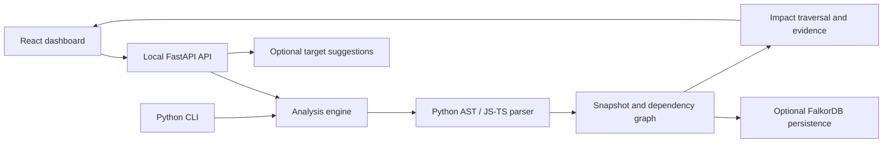

# GraphScope

Understand the potential blast radius of a code change before making it.

GraphScope maps source dependencies, traces callers and affected API endpoints,
compares Git revisions, and inspects dependencies across declared service workspaces.
Findings include source locations, resolution rules, and explicit analysis limitations.

**Status:** local-first hackathon beta. Python and a subset of JavaScript/TypeScript
are supported. Results describe potential static impact, not guaranteed runtime behavior.

## What you can do

| Analysis mode | Purpose |
|---|---|
| Repository mapping | Explore functions, resolved calls, endpoints, and resource accesses. |
| Selected targets | Trace potential impact from one or more exact function names or a literal resource identity. |
| Proposed change | Describe an intended change, review candidate functions, and confirm targets before calculating impact. |
| Git changes | Map worktree, staged, or committed edits to symbols and inspect before/after impact. |
| Service workspace | Map declared services and infer HTTP/message dependencies, with service filtering and contract evidence. |

The React dashboard includes graph fitting, zoom/pan, node selection, dependency
evidence, grouped coverage reporting, and JSON export. Static test links identify
resolved caller relationships to tests; they do not execute tests or measure runtime coverage.

## Quick start

Requires Git, Python **3.11+**, and Node.js **22.12+**. Release verification uses Node 24.
Run from a source checkout so the dashboard and parser assets remain available.

```sh
git clone https://github.com/Souhardya0903/GraphScope.git
cd GraphScope
```

### Windows PowerShell

```powershell
powershell -ExecutionPolicy Bypass -File scripts/setup.ps1
.\.venv\Scripts\python.exe -m graphscope serve --port 8080
```

### Linux / macOS

```sh
sh scripts/setup.sh
.venv/bin/python -m graphscope serve --port 8080
```

Open **http://127.0.0.1:8080** and choose **Repository analysis**. Setup creates the
virtual environment, installs dependencies and the JavaScript parser, and builds the dashboard.

All five repository-analysis modes work without Docker, FalkorDB, or an LLM key.
The separate stored-snapshot investigation workflow requires FalkorDB.

For an external repository, allow its directory when launching:

```powershell
.\.venv\Scripts\python.exe -m graphscope serve --allow-root "D:\YourRepository"
```

Use `.venv/bin/python` on Linux/macOS. Repeat `--allow-root` for additional roots.
Bundled project examples are allowed by default. Keep the server terminal running;
use a hard browser refresh after rebuilding the frontend.

## First demonstration

Use these inputs in the dashboard:

| Field | Value |
|---|---|
| Analysis mode | Selected targets |
| Repository path | `examples/commerce` |
| Qualified targets | `inventory.validate_stock` |
| Resource identity | Empty |

Click **Analyze repository**. Potentially affected endpoints include **POST `/orders`**
and **POST `/reservations`**. Select `orders.place_order` from the function list to
inspect dependency evidence. Endpoint graph edges use declared handlers rather than
layout guesses.

For a multi-service example, choose **Service workspace** and enter
`examples/workspace/workspace.json`. Leave service/target fields empty for the map.
Then use service `stock` and target `app.validate_stock` for cross-service impact.
HTTP and message links are inferred from explicit workspace contracts, not observed traffic.

See [Testing each analysis mode](#testing-each-analysis-mode) below for a repeatable
checklist. Examples are bundled in Git; locally cloned third-party repositories and
generated reports are not.

## Optional LLM suggestions

**Proposed change** supports offline lexical matching, Gemini, Ollama Cloud, and OpenAI.
Click **Describe a change**, choose a provider, and leave targets empty to request suggestions.
The UI asks permission to share the description and symbol catalog. Review the candidate,
select it, and explicitly confirm before calculating static impact. Confirmation does
not make another model request. Provider failures offer an offline fallback.

Create an ignored `.env` file using `.env.example` as a template, without overwriting
existing configuration. Set the selected provider's key and a tool-capable model ID
available to your account:

```dotenv
GEMINI_API_KEY=your-key
GEMINI_MODEL=your-model
# Alternatives:
# OLLAMA_API_KEY / OLLAMA_MODEL
# OPENAI_API_KEY / OPENAI_MODEL
```

Restart the server after changing configuration. Credentials stay on the server.
Proposal requests send a description, symbol names/IDs, and relative file paths;
they exclude source contents. Catalogs are limited to **300 functions / 45,000
characters**, with a 30-second model-request timeout. Larger repositories can use
offline matching or explicit targets. Provider access and quota are account-dependent.

LLMs suggest targets and manual checks. Source analysis and graph traversal establish
the reported dependencies; model text cannot supply dependency edges.

## CLI

PowerShell examples, from the checkout root:

```powershell
.\.venv\Scripts\python.exe -m graphscope.analysis map examples/commerce --output reports/commerce-map.json
.\.venv\Scripts\python.exe -m graphscope.analysis impact examples/commerce --target inventory.validate_stock --output reports/commerce-impact.json
.\.venv\Scripts\python.exe -m graphscope.analysis changes examples/commerce --base HEAD --head worktree --output reports/commerce-changes.json
.\.venv\Scripts\python.exe -m graphscope.analysis workspace examples/workspace/workspace.json --output reports/workspace-map.json
```

Use `.venv/bin/python` on Linux/macOS. Additional examples:

```powershell
.\.venv\Scripts\python.exe -m graphscope.analysis propose examples/commerce "Change validate_stock" --target inventory.validate_stock --confirm
.\.venv\Scripts\python.exe -m graphscope.analysis impact examples/workspace/stock --resource redis:inventory
.\.venv\Scripts\python.exe -m graphscope.analysis workspace examples/workspace/workspace.json --service stock --target app.validate_stock
```

Run `python -m graphscope.analysis MODE --help` for each command's options. For
Git comparisons, use `--head index` for staged edits or a commit/ref for another revision.

## Optional FalkorDB snapshots and investigations

FalkorDB stores snapshots for the separate **Stored snapshot investigation** workflow.
For a local Docker installation:

```sh
docker compose up -d --wait
```

Configure `.env` for your local instance or FalkorDB Cloud, then verify connectivity:

```powershell
.\.venv\Scripts\python.exe scripts/check_falkordb.py
.\.venv\Scripts\python.exe -m graphscope.analysis map examples/commerce --store --output reports/commerce-stored.json
```

The check uses a disposable graph. The stored map includes a snapshot `id` that can
be selected in the dashboard or passed to `python -m graphscope.investigation`.
Stored investigation supports direct deterministic analysis and optional model providers.
Source excerpts in that workflow are opt-in and checked against indexed hashes.

## Coverage and limits

- Python resolution supports explicit imports, unambiguous re-exports, package/submodule
  calls, and a bounded subset of class-method lookup and FastAPI routes.
- Dynamic dispatch, arbitrary decorators, nested functions, runtime-generated routing,
  and other unsupported patterns can leave dependencies unresolved.
- JavaScript/TypeScript analysis supports a subset of functions/imports and literal
  HTTP calls. Java and universal framework/language support are not implemented.
- Resource identities and cross-service contracts can be inferred and require review.
- Analysis coverage separates repository-wide limitations, unresolved calls inside
  found affected functions, and builtin calls. The scoped view does not prove other
  code is unrelated; unresolved incoming calls may hide additional dependents.
- Graph previews are bounded; exports preserve full report relationships. Traversal
  truncation and depth limits are explicitly reported.

An empty impact result does not establish safety. Analysis never imports or executes
repository source. This beta binds to loopback and assumes a trusted local operator;
public multi-user hosting, tenant isolation, and authentication are not implemented.

## Verification

After setup:

```powershell
.\.venv\Scripts\python.exe -m graphscope doctor
.\.venv\Scripts\python.exe -m ruff check src tests examples
.\.venv\Scripts\python.exe -m pytest tests/unit -q
npm --prefix frontend run build
npm --prefix frontend test -- --maxWorkers=1
npm --prefix frontend exec -- playwright install chromium
npm --prefix frontend run test:e2e
```

Use `.venv/bin/python` on Linux/macOS. Browser tests launch their own server on
port 8765; keep it free. Tests using optional local third-party clones may be skipped
on a fresh checkout. FalkorDB integration tests require `GRAPHSCOPE_INTEGRATION=1`
and a configured reachable instance. Normal automated checks do not call paid models.

## Project layout

```text
frontend/                 React + TypeScript dashboard and browser tests
src/graphscope/
  ingestion/              Python AST extraction and dependency resolution
  analysis/               Maps, changes, proposals, impact, and service workspaces
  api/                    Local FastAPI endpoints and filesystem boundaries
  graph/                  FalkorDB snapshot persistence and queries
  investigation/          Bounded optional model/tool investigation
  models.py               Shared report and snapshot contracts
examples/commerce/        Bundled function/endpoint demonstration
examples/workspace/       Bundled Python/TypeScript service contracts
scripts/                  Setup and database verification
tools/javascript/         JavaScript/TypeScript source parser
tests/                    Unit, fixture, and integration checks
```

## How the pieces connect



The dashboard lives in `frontend/`; API routes in `src/graphscope/api/` delegate to
`analysis/`. Python extraction uses `ingestion/`; JavaScript/TypeScript extraction
uses `tools/javascript/`. Offline reports use the extracted graph directly.
`graph/` and `investigation/` support stored-snapshot investigations. Setup scripts
install these components; tests validate their contracts and browser workflows.

## Testing each analysis mode

Run the server from the checkout root, open the dashboard, and use the bundled
examples. Paths below are relative to the checkout, so another developer does not
need the original author's filesystem paths or ignored cloned repositories.

| Mode | Inputs | Expected result |
|---|---|---|
| Repository mapping | Root `examples/commerce` | Nonzero function counts, resolved dependencies, endpoints, and inspectable limitations. |
| Selected targets | Root `examples/commerce`; target `inventory.validate_stock`; resource empty | POST `/orders` and POST `/reservations` are potentially affected; GET `/products` is not. Select `orders.place_order` for evidence. |
| Resource impact | Selected targets mode; root `examples/workspace/stock`; targets empty; resource `redis:inventory` | `app.read_stock` and the stock route are identified through the inferred resource access. |
| Proposed change | Root `examples/commerce`; description `Change validate_stock to reject zero quantity` | Review the candidate, select it, check confirmation, and run again to obtain impact. Model providers additionally require catalog-sharing consent. |
| Git changes | Root `examples/commerce`; base `HEAD`; compare `worktree` | Add a temporary comment inside `validate_stock` in `examples/commerce/inventory.py` and save. Changed-symbol and before/after results appear. Remove only that comment afterward. |
| Workspace map | Manifest `examples/workspace/workspace.json`; service/target/changed-service empty | Three service cards, aggregate totals, inferred contract evidence, graph, and working service filtering. |
| Workspace target impact | Same manifest; service `stock`; target `app.validate_stock`; changed-service empty | Potential stock-route and client impact through an inferred HTTP contract. |
| Workspace Git impact | Same manifest; changed-service `stock`; service and target empty; HEAD versus worktree | Temporarily edit inside `validate_stock` in `examples/workspace/stock/app.py`; inspect before/after impact and undo that temporary edit. |

Check JSON export, node selection, long-name tooltips, zoom/pan, Fit graph, and a
narrow browser window. Invalid paths and nonexistent targets should produce visible
errors. Changing inputs should clear previous results. Inspect both affected scope
and Whole repository in the coverage panel. Model failures should offer an offline fallback.

For a bug report, include the commit (`git rev-parse --short HEAD`), OS, Python/Node
versions, mode, exact inputs, reproduction steps, expected/actual result, and screenshot
or sanitized error. Do not share `.env`, keys, passwords, or private source.

## Troubleshooting

| Symptom | Action |
|---|---|
| Cannot reach API | Keep the server running and open its exact URL. |
| Old frontend | Rebuild with `npm --prefix frontend run build`, then hard-refresh. |
| Port 8080 busy | Launch with `--port 8081` and open that port. |
| External root rejected | Restart with `--allow-root` for the repository/workspace directories. |
| JS/TS parser unavailable | Run `npm ci --prefix tools/javascript --ignore-scripts`. |
| No Git changes found | Save the edit, use `worktree`, and inspect `git diff`. |
| Model catalog too large | Use a smaller source root, offline matching, or exact targets. |
| Model credentials changed | Restart the server; credentials are loaded on startup. |

Fixture-specific details remain in [commerce](examples/commerce/README.md) and
[workspace](examples/workspace/README.md). This README is the main setup and testing reference.

## License

[MIT](LICENSE).
